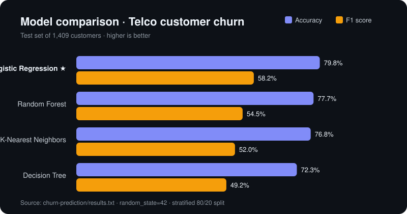

# 📊 Summer 2026 Internship: Machine Learning Projects


A collection of machine learning experiments from my summer 2026 internship. The main project predicts **customer churn** for a telecom company. The `practice/` folder holds smaller exercises on house prices and Titanic survival.

---

## ⭐ Featured project: Telco Customer Churn

**Goal:** Predict which customers will cancel their service so the business can target them with retention offers.

| | |
|---|---|
| **Dataset** | IBM Telco Customer Churn (7,043 customers, 21 columns) |
| **Problem type** | Binary classification (`Churn`: Yes / No) |
| **Class balance** | 26.5% churned · 73.5% stayed |
| **Models compared** | Logistic Regression · Decision Tree · Random Forest · K-Nearest Neighbors |

### 🏆 Results



| Model | Accuracy | Precision | Recall | F1 Score |
|---|:---:|:---:|:---:|:---:|
| **Logistic Regression** 🥇 | **0.798** | **0.645** | **0.529** | **0.582** |
| Random Forest | 0.777 | 0.595 | 0.503 | 0.545 |
| K-Nearest Neighbors | 0.768 | 0.577 | 0.473 | 0.520 |
| Decision Tree | 0.723 | 0.479 | 0.505 | 0.492 |

**Logistic Regression** gave the best overall balance and was the top model on every metric. It's also the simplest and easiest to explain to a non-technical audience.

### 🔍 Key takeaways

- **Accuracy alone is misleading here.** Always guessing "no churn" would already score about 73%, so F1 score is the more useful number.
- **The best model catches about half of churners.** Recall is 0.53, so roughly 1 in 2 customers who leave is still missed. Improving that is the main next step.
- **Logistic Regression confusion matrix** (test set, n = 1,409):

  |  | Predicted: stay | Predicted: churn |
  |---|:---:|:---:|
  | **Actual: stay** | 926 ✅ | 109 |
  | **Actual: churn** | 176 | 198 ✅ |

### ⚙️ Pipeline

```
Raw CSV ─► Clean ─► Select 10 features ─► One-hot encode ─► Split 80/20 (stratified) ─► Scale ─► Train 4 models ─► Compare
```

1. **Clean:** convert `TotalCharges` to numeric and fill the 11 blank values with the median. Map `Churn` to 0/1.
2. **Features:** tenure, monthly and total charges, senior status, contract type, internet service, payment method, paperless billing, tech support, and online security.
3. **Split:** 5,634 training and 1,409 test samples, `random_state=42`, stratified on churn.
4. **Scale and train:** standardize features, then fit each model.

---

## 🧪 Practice exercises

Smaller experiments from earlier in the internship, in [`practice/`](practice/):

| Topic | Files | What it covers |
|---|---|---|
| House prices (Melbourne) | `linearreg.py`, `housepricesdecisiontree.py`, `housepricesrandomtree.py`, `missingprices.py`, `categoricalvariables.py` | Regression, handling missing data and categorical variables |
| Pipelines & validation | `pipelines.py`, `crossvalidation.py`, `dataleakage.py` | Building pipelines, cross-validation, avoiding data leakage |
| Gradient boosting | `boostedRTR.py` | XGBoost regression |
| Titanic survival | `titanicproj.py`, `titanproj.py`, `titanforest.py`, `titanrandfor.py` | Classification with tree-based models |
| Sandbox | `trial.py` | Scratch work |

---

## 📁 Repository layout

```
internship_summer2026/
├── churn-prediction/           ⭐ Main project
│   ├── custfinal.py            Full pipeline: clean → train → evaluate
│   ├── results.txt             Saved console output from the last run
│   └── WA_Fn-UseC_-Telco-Customer-Churn.csv
├── practice/                   Smaller ML exercises + datasets
├── docs/
│   └── model-comparison.svg    Results chart
└── README.md
```

## 🚀 Run it yourself

Requires Python 3.10+ with `pandas`, `scikit-learn`, and `numpy`.

```bash
pip install pandas scikit-learn numpy
cd churn-prediction
python custfinal.py
```

The script reads the CSV from the current folder, so run it from inside `churn-prediction/`.

## 🔮 Next steps

- [ ] Tune the classification threshold to raise recall (catch more churners)
- [ ] Try class weighting or SMOTE to handle the 26/74 imbalance
- [ ] Add ROC-AUC and a precision-recall curve
- [ ] Use all 19 features instead of the selected 10 and check whether recall improves

---

<p align="center"><sub>Built during the Summer 2026 internship · Python · scikit-learn · pandas</sub></p>
